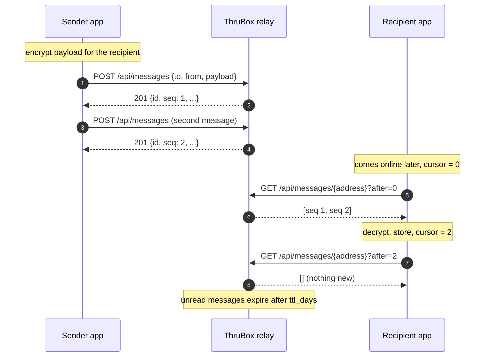
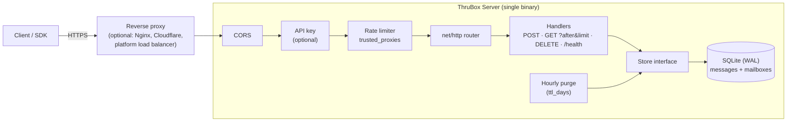

🎉 **ThruBox Server 1.0 is here.** It is the first stable release of a small, self-hostable relay that works as a *dumb encrypted mailbox*. Apps put encrypted messages in a recipient's mailbox and the recipient picks them up later, even if the two were never online at the same time. The server stores and forwards opaque blobs and never sees plaintext; all encryption happens in the client.

ThruBox is one Go binary with an embedded SQLite database. It has no message broker, no external database and no peer-to-peer network to join. You can run your own relay or use someone else's. [Chainvoice](https://github.com/AOSSIE-Org/Chainvoice) is the first app built on it, and any app can use it through the [TypeScript SDK](https://github.com/AOSSIE-Org/ThruBox-Client) or plain HTTP.

"1.0" means the HTTP API and the configuration format are stable. Later 1.x releases add to them without breaking existing clients or `config.yaml` files.

## Highlights

- **A REST API you can use with `curl`.** Four endpoints: put a message in a mailbox, read a mailbox, delete a message, and a health check. Payloads are opaque strings up to 500 KB by default.
- **Per-mailbox cursors.** Every message gets a `seq`, its position in the recipient's mailbox: 1, 2, 3, and so on. `GET /api/messages/{address}?after=<seq>&limit=<n>` returns only what a client has not handled yet, so polling no longer downloads the whole mailbox every time. Sequence numbers only go up and are never reused, even after deletes or expiry, so a cursor never skips a message. Each device keeps its own cursor and the server stores no per-client state. (#69, #67)
- **Content-derived message IDs.** A message's `id` is the SHA-256 of its recipient, sender and payload. Sending the exact same message again is safe: nothing new is stored and the server returns the existing message with `200` instead of `201`. (#69, #67)
- **Rate limiting that clients cannot fake.** By default the limiter keys on the connecting address and ignores `X-Forwarded-For` / `X-Real-IP`. Behind a reverse proxy, set `trusted_proxies: N` and the client IP is read from the Nth `X-Forwarded-For` entry counted **from the right**, the last one your own proxy wrote. Before this fix, rotating a fake header bypassed the limit entirely. (#68, #67)
- **Automatic expiry.** Messages expire after `ttl_days` (7 by default). A background job purges them every hour. Set `ttl_days: 0` to keep messages until they are deleted.
- **CORS for browser apps.** Static front ends, such as one hosted on GitHub Pages, can call the relay directly. List the allowed origins in `allowed_origins`; it is off by default. (#32, #36)
- **Optional API key.** Set `api_key` to turn a relay into a private one: every request then needs the `X-API-Key` header. `/health` stays open for health checks.
- **Configuration that works on hosting platforms.** Settings come from `config.yaml` and/or `RELAY_*` environment variables. The server also honours `PORT` (Render, Railway, Heroku, Cloud Run), and `RELAY_CONFIG_PATH` points it at a config file anywhere. Invalid values stop the server at startup instead of being silently ignored. (#26, #27, #34, #35)
- **Docker images.** Multi-arch images (`linux/amd64`, `linux/arm64`) are published to GitHub Container Registry with provenance attestations and an SBOM. (#12, #18)
- **Self-hosting guides.** Step-by-step guides cover putting the relay behind Nginx with Let's Encrypt or behind a Cloudflare Tunnel, plus a post-deployment security checklist. Thanks @tarunagnihotri534! (#11, #50)

## How it works



## Architecture



## Getting started

```bash
docker run -d --name thrubox \
  -p 127.0.0.1:3000:3000 \
  -v thrubox-data:/data \
  ghcr.io/aossie-org/thrubox-server:1.0.0

curl http://127.0.0.1:3000/health
```

Then send and read a message:

```bash
curl -X POST http://127.0.0.1:3000/api/messages \
  -H "Content-Type: application/json" \
  -d '{"to":"0xRecipient","from":"0xSender","payload":"<ciphertext>"}'

curl "http://127.0.0.1:3000/api/messages/0xRecipient?after=0"
```

From TypeScript, use [`@aossie-org/thrubox-client`](https://www.npmjs.com/package/@aossie-org/thrubox-client) **1.1.0 or later** for cursor support. Earlier SDK versions keep working, but they read the whole mailbox on every poll.

## Before you deploy

- **Behind a proxy? Set `trusted_proxies`.** With the default `0`, every request appears to come from the proxy, so all your users share one rate-limit bucket and get `429` together. A single proxy (Nginx, Cloudflare Tunnel, Render and similar platforms) is `RELAY_SECURITY_TRUSTED_PROXIES=1`. Only the proxy should be able to reach the relay. See [Behind a Reverse Proxy](https://github.com/AOSSIE-Org/ThruBox-Server#behind-a-reverse-proxy).
- **Upgrading from a pre-release build of `main`?** On first start the database is migrated in place: existing messages get sequence numbers in the order they arrived. Their old UUID IDs stay valid; only new messages get hash IDs. The `google/uuid` dependency is gone.
- **Persist `/data`.** Messages live in `/data/relay.db` inside the container. Without a volume they disappear when the container is replaced, which also happens on free hosting tiers that have no persistent disk.

## Known limitations

ThruBox keeps the server deliberately simple, and in 1.0 that has a trade-off you should know about:

- **Mailboxes are not authenticated.** Anyone who knows an address can read the encrypted messages waiting for it, and anyone who knows a message ID can delete it. Confidentiality comes from client-side encryption, but a hostile caller can still see message metadata or delete messages before the recipient reads them. Wallet-signature authentication for reads and deletes is designed and planned for a 1.x release. Until then, use the API key, the rate limit and short TTLs if this matters for your deployment.
- **One server, one database file.** There is no replication or clustering; scale by running separate relays.
- **Docker is the supported way to run it.** No prebuilt binaries are attached to this release. To run without Docker, build from source with Go 1.23+ and a C compiler (`CGO_ENABLED=1`).

## Resources

- [README: API, configuration and self-hosting guides](https://github.com/AOSSIE-Org/ThruBox-Server#readme)
- [TypeScript SDK](https://github.com/AOSSIE-Org/ThruBox-Client)
- [Changelog](https://github.com/AOSSIE-Org/ThruBox-Server/blob/main/CHANGELOG.md)
- Questions and discussion: the [AOSSIE Discord](https://discord.gg/hjUhu33uAn), #thrubox channel
- Bugs and feature requests: [issue tracker](https://github.com/AOSSIE-Org/ThruBox-Server/issues)

Thank you to the AOSSIE mentors for the design reviews behind this release, and to everyone who reported issues, reviewed pull requests and tested the relay with Chainvoice. 💚
